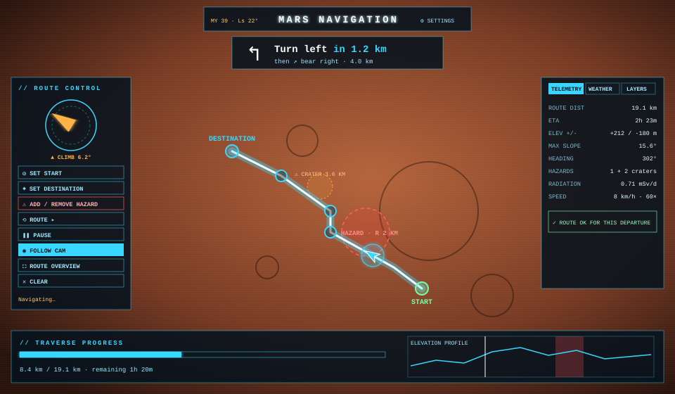
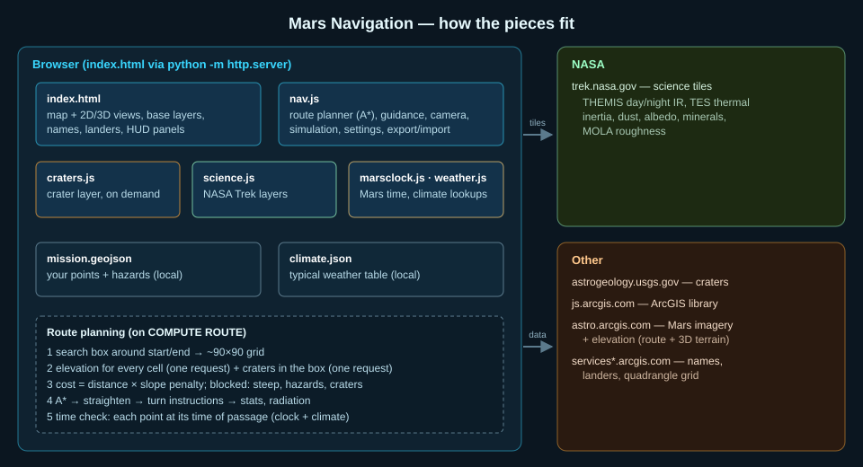

# Mars Navigation — astronaut / rover route planner (demo)

A browser app that shows Mars as a 2D map or a 3D globe and plans drivable routes for an
astronaut or rover: it avoids steep terrain, craters and hazard zones, gives Waze-style
turn-by-turn guidance, simulates the drive, and checks the route against the time of day,
temperature, wind, dust and darkness at the moment the vehicle passes each point.



*Illustration of the HUD layout. Add real screenshots to `docs/screenshots/` (see [Screenshots](#screenshots)).*

> **Demo / research prototype.** Terrain, crater, climate and radiation values are taken
> from public datasets and simple models. They are good for exploring ideas, **not** for
> real mission safety decisions.

---

## Contents
- [Features](#features)
- [Quick start](#quick-start)
- [5-minute demo](#5-minute-demo)
- [Project structure](#project-structure)
- [How the route planner works](#how-the-route-planner-works)
- [Data sources](#data-sources)
- [Settings](#settings)
- [File formats](#file-formats)
- [Limitations](#limitations)
- [Roadmap](#roadmap)
- [Screenshots](#screenshots)
- [Credits and data terms](#credits-and-data-terms)

---

## Features

**Map and globe**
- 3D Mars globe with real elevation, or a flat 2D map, with one button to switch between them.
- Base imagery (Viking color mosaic), shaded relief, CTX and HiRISE mosaics.
- 1,879 official IAU feature names, the 15 landers and rovers with leader-line labels, and your own mission points.
- **Science layers (NASA Mars Trek):** THEMIS day and night infrared (100 m), TES thermal inertia, dust index, surface dust, albedo, minerals (pyroxene, plagioclase, sheet silicates), MOLA roughness.
- **Crater layer (USGS Robbins database):** loaded only for the area you look at or plan in. Labels are prioritized by size and never overlap.

**Route planning**
- Set the start and destination by **clicking the map** or **searching by name** ("Jezero", "Gale", "Perseverance", …).
- The planner finds a path that avoids:
  - slopes above the drivable limit (real elevation);
  - small craters, with a rim safety margin;
  - manual hazard zones (0.5–10 km radius) and hazards from `mission.geojson`.
- Straightened path (no grid zigzag) with turn-by-turn instructions: bear, turn or sharp, left or right.
- **Auto-recompute** on any change, or manual **COMPUTE ROUTE**; outdated routes are shown grey and dashed.
- **Export / import routes as JSON** to share them.

**Navigation and simulation**
- Turn-by-turn banner ("↰ Turn left in 1.2 km · then ↗ bear right"), progress bar and elevation profile.
- **Follow camera** (behind and above the vehicle, heading-up) or **route overview** (fit the route, or track the vehicle).
- Speed in km/h with a time warp; the camera height grows with speed and its tilt follows the climb.
- The compass arrow head widens when climbing and narrows when descending.

**Time and environment**
- **Mars clock** (NASA Mars24 algorithm): Mars Year, season (Ls) and local solar time at the vehicle.
- **Departure time:** now or a chosen UTC time; every route point gets a time of passage.
- **WEATHER tab:** typical air and ground temperature, pressure, wind, dust and dust-devil risk.
- **Time check:** flags too cold, too hot, too windy, too dusty or dark stretches (red bands on the profile) and **suggests the earliest safe departure**.
- **Radiation estimate:** dose rate and route dose, scaled from Curiosity RAD measurements by air column (elevation).

---

## Quick start

Requirements: a modern browser (Chrome, Edge, Firefox) and Python 3 (only to serve the files).

```bash
cd mars-map
python -m http.server 8000
```

Open **http://localhost:8000**. An internet connection is needed: the map library, imagery,
elevation, craters and science layers are loaded from the web.

> Opening `index.html` directly as a file (`file://…`) does not work. Browsers block the
> data loading, so always use the small server above.

---

## Quick operation guide

1. **Explore.** The globe opens near Jezero Crater. Drag to rotate, scroll to zoom and right-drag to tilt.
   In **LAYERS → Science (NASA Trek)**, switch on *Night infrared, THEMIS* and compare it with *Day infrared*.
2. **Pick points by name.** Click **◎ SET START**, type `perse` and press Enter (Perseverance landing site).
   Then click **⌖ SET DESTINATION** and click a spot about 15–20 km away on the crater floor.
3. **Add a hazard.** Click **⚠ ADD / REMOVE HAZARD**, choose *HAZARD RADIUS 2 km* and click on the straight line between the points.
4. **Plan.** Open **⟲ ROUTE ▸** and press **COMPUTE ROUTE**. The route bends around the hazard and the
   orange dotted craters, and the TELEMETRY tab fills in.
5. **Check the time.** In the ROUTE panel set **DEPARTURE → set time** to a late afternoon (local time is shown).
   The WEATHER tab will flag "dark" or "too cold"; press **⏱ USE SUGGESTED DEPARTURE**.
6. **Drive.** Press **▶ SIMULATE**. Watch the turn banner, compass, progress bar and SIM clock.
   Use **+ / −** to change speed, and switch between **FOLLOW CAM** and **ROUTE OVERVIEW → TRACK**.
7. **Share.** **⟲ ROUTE ▸ → EXPORT ROUTE** downloads a `.json` file that anyone can **IMPORT**.

---

## Project structure



| File | What it does |
|---|---|
| `index.html` | Page, HUD panels and styles; creates the map, 2D/3D views, base layers, feature names, landers and mission points; wires everything together. |
| `nav.js` | Navigation system: planner (grid + A*), path straightening, turn instructions, hazards, place search, follow/overview camera, simulation, settings panel, export/import, time & environment checks, radiation estimate. |
| `craters.js` | Crater layer: fetches USGS craters on demand (route area or visible 2° tiles), draws zones and labels, tells the planner which craters to avoid. |
| `science.js` | NASA Mars Trek science layers, re-tiled to match the Esri Mars basemap so they work in 2D and 3D. Add a Trek layer with one line. |
| `marsclock.js` | Mars clock: Ls, Mars Year, sol, local mean and true solar time, sun elevation, sunrise and sunset (Mars24). |
| `weather.js` | Reads `climate.json` once and interpolates typical conditions for any place and time. |
| `climate.json` | Climate table (season × hour). The included one has **approximate** values for Jezero. |
| `mission.geojson` | Your mission points (bases, waypoints) and hazard zones. |
| `docs/` | Diagrams for this README (and your screenshots). |

---

## How the route planner works

1. **Search area.** A box around start and destination (widened automatically if everything inside is blocked).
2. **Grid.** About 90 × 90 cells; the elevation of every cell comes from **one** request to the Mars elevation service.
3. **Craters.** **One** request to the USGS crater database for the same box. Craters between the min and max size
   become no-go zones, with a rim factor. Large craters such as Jezero are left to the slope check, since their floors are drivable.
4. **Cost.** distance × (1 + slope weight × slope). Blocked cells: slope above the maximum, inside a hazard or crater zone (plus a one-cell margin).
5. **A\*** finds the cheapest path. It is then **straightened** (string pulling: straight lines wherever they stay safe) and re-sampled with real elevation.
6. **Instructions.** Corners turning more than the minimum angle become *bear / turn / sharp left/right*.
7. **Stats.** Distance, ETA at the set speed, elevation gain and loss, maximum slope, estimated radiation dose.
8. **Time check.** Each point is checked at its time of passage (departure + distance ÷ speed) against the climate table and the sun
   elevation. If it fails, departures every 15 min over ~1.5 sols are tried, and the earliest safe one is suggested.

---

## Data sources

Loaded while the app runs:

**NASA**

| Source | Used for |
|---|---|
| `trek.nasa.gov/tiles/Mars/EQ/…` (NASA Mars Trek) | Science layers (THEMIS, TES, MOLA roughness). Only when switched on, only the visible area. |

**Other**

| Source | Used for |
|---|---|
| `astrogeology.usgs.gov/pygeoapi/…/robbinsv1` (USGS) | Robbins crater database: crater layer and planner. |
| `js.arcgis.com/4.31/` (Esri) | ArcGIS Maps SDK for JavaScript (map engine). |
| `astro.arcgis.com/…/OnMars/…` (Esri) | MDIM, color relief, CTX and HiRISE imagery; **MDEM200M elevation** (3D terrain and planner). |
| `services.arcgis.com/…/Mars_Nomenclature_All` | IAU feature names: labels and search. |
| `services.arcgis.com/…/Mars_Quadrangle_Grid` | Quadrangle grid layer. |
| `services2.arcgis.com/…/mars_artificial_objects` | Landers and rovers. |

Local files: `climate.json`, `mission.geojson`.

Climate values in `climate.json` were approximated from published Perseverance/MEDA results.
The planned upgrade is tables from the **Mars Climate Database** (LMD/ESA/CNES), prepared offline, never queried live.

---

## Settings

Open **⚙ SETTINGS**. Changes apply live and are remembered by the browser; **RESET TO DEFAULTS** restores them.

| Section | Settings |
|---|---|
| Simulation | Vehicle speed (km/h), time warp |
| POV zoom vs speed | Base camera height, height per km/h |
| POV pitch vs climb | Pitch on level ground, pitch change per ° of slope, min/max pitch, camera responsiveness |
| Turn guidance | Straighten path, minimum angle for an instruction (default 10°), ignore wiggles smaller than |
| Route planning | Max drivable slope (20°), slope avoidance |
| Online hazard data | Avoid craters, smallest/largest crater to avoid, rim safety factor, crater layer load zoom |
| Time & environment limits | Check on/off, rover min/max temperature, use ground temperature, max wind, max dust, allow darkness, min sun elevation |
| Radiation estimate | Dose at Gale Crater (0.67 mSv/day), sensitivity to air column |

> The rover temperature, wind and dust limits are **placeholders**. Set your vehicle's real values.

Keyboard: **+ / −** change speed by 5 km/h; in the place search **↑ ↓ Enter Esc**.

---

## File formats

### Route file (export / import)
```json
{
  "format": "mars-nav-route", "version": 1,
  "name": "Route N 18.440° E 77.450° → N 18.600° E 77.200°",
  "crs": { "wkid": 104971, "name": "GCS Mars 2000 (sphere)", "units": "degrees; elevation in meters" },
  "start": { "lon": 77.45, "lat": 18.44 },  "end": { "lon": 77.2, "lat": 18.6 },
  "departure_utc": "2026-11-16T19:45:00.000Z",
  "hazards": [ { "lon": 77.3, "lat": 18.5, "radius_km": 2, "name": "Hazard 2 km", "source": "manual" } ],
  "craters_avoided": [ { "id": "13-002510", "lon": 77.167, "lat": 18.713, "no_go_radius_km": 2.059 } ],
  "planning": { "maxSlopeDeg": 20, "minTurnDeg": 10, "speedKmh": 8 },
  "time_check": { "ok": true, "first_problem": null, "suggested_departure_utc": null },
  "stats": { "distance_km": 19.1, "eta_h": 2.39, "gain_m": 212, "loss_m": 180, "max_slope_deg": 15.6, "dose_msv_est": 0.07 },
  "maneuvers": [ { "index": 12, "at_km": 3.4, "turn_deg": -48, "instruction": "Turn left", "icon": "↰" } ],
  "path": [ [77.45, 18.44, -2551.2], [77.447, 18.442, -2553.0] ]
}
```

### `mission.geojson`
Standard GeoJSON points, with **Mars** longitude and latitude in degrees (east positive):
```json
{ "type": "Feature",
  "properties": { "name": "Hazard: dune field", "kind": "hazard", "radius_km": 4, "notes": "Soft sand" },
  "geometry": { "type": "Point", "coordinates": [77.32, 18.53] } }
```
`kind`: `base`, `waypoint` or `hazard`. Hazards are avoided by the planner; every named point is searchable.

### `climate.json`
```text
{ "format": "mars-climate-table", "version": 1,
  "ls": [0, 30, …, 330],  "hours": [0, 1, …, 23]   (Local True Solar Time),
  "sites": [ { "name", "lat", "lon", "elev_m",
               "vars": { "air_temp_C", "ground_temp_C", "pressure_Pa", "wind_ms",
                         "wind_from_deg", "dust_tau", "dust_devil_index" } } ] }
```
Each variable is a 12 × 24 grid (season × hour). Add more sites to cover more of Mars; the nearest ones are used.

---

## Limitations

- **Elevation is ~200 m per cell.** The planner sees crater walls, canyons and large slopes, not rocks or small scarps.
- **Craters ≥ 1 km only** (Robbins database). Dune fields, soft-dust maps and HiRISE terrain are not used by the planner yet.
- **Climate is typical, not live**, and the included table is approximate and covers **Jezero only**. Far from Jezero its values are not meaningful.
- **Radiation** is a cosmic-ray estimate scaled by elevation; solar particle events are not modeled.
- Science layers from Trek are display images (relative brightness), not calibrated measurements. THEMIS covers 65°S–65°N.
- Needs an internet connection; it is a demo for ideas and training, not a flight or operations tool.

---

## Roadmap

- Mars Climate Database tables for more sites (script to generate `climate.json`).
- "Soft ground" cost from THEMIS night IR / thermal inertia.
- Dune fields (USGS dune database) as no-go zones.
- Simulated dust devils as moving hazards, from the climate table's dust-devil index.
- Split long routes into daily legs (stop at a waypoint, continue next sol).
- Live vehicle position from a small Python server.

---


---

## Credits and data terms

- **Map engine:** [ArcGIS Maps SDK for JavaScript](https://developers.arcgis.com/javascript/) (Esri). Mars imagery and elevation services are hosted by Esri (data from NASA/JPL, USGS, University of Arizona and others).
- **Science layers:** [NASA Mars Trek](https://trek.nasa.gov/mars/).
- **Craters:** Robbins & Hynek Mars crater database, served by the [USGS Astrogeology Science Center](https://astrogeology.usgs.gov/).
- **Feature names:** IAU / USGS Gazetteer of Planetary Nomenclature.
- **Landers & rovers layer:** "Mars artificial objects" (ArcGIS Online).
- **Mars clock:** NASA GISS Mars24 algorithm (Allison & McEwen 2000).
- **Climate (planned):** [Mars Climate Database](https://www-mars.lmd.jussieu.fr/) (LMD/OU/IAA/ESA/CNES). Note its terms: the web interface is for moderate use, and no commercial use without authorization.
- **Climate (current approximation) and radiation reference:** published Mars 2020 MEDA and MSL RAD results.

Check each provider's terms before using this beyond a personal or educational demo.
